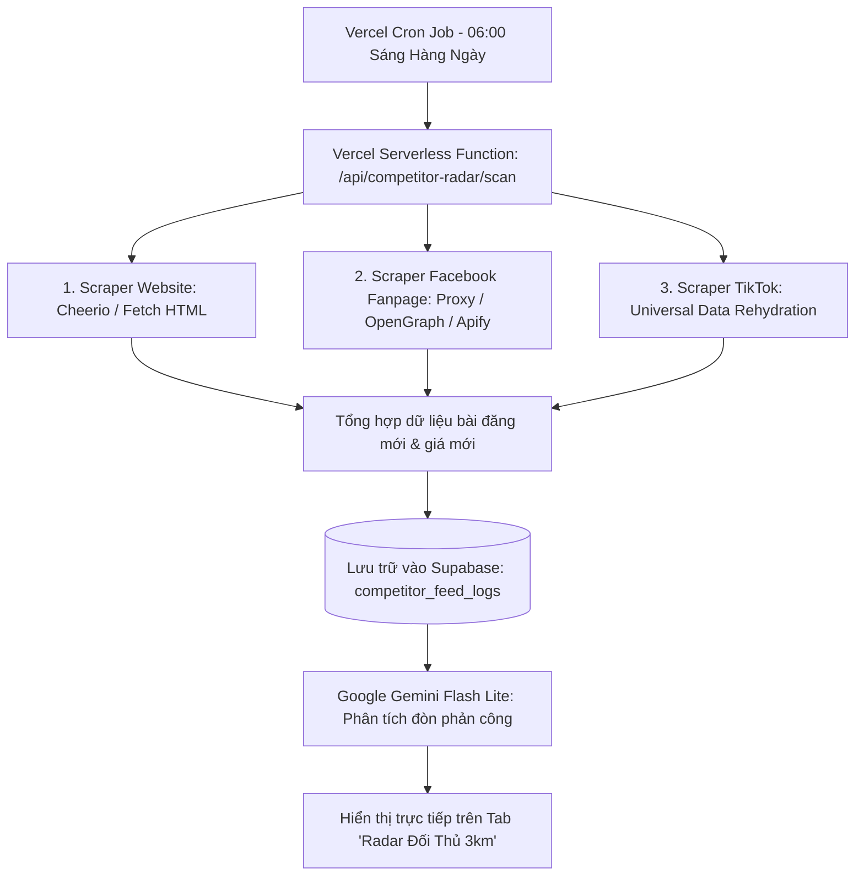

# KẾ HOẠCH CHI TIẾT: CÀO DỮ LIỆU TỰ ĐỘNG WEBSITE, FANPAGE FACEBOOK & TIKTOK ĐỐI THỦ
**Dự án:** PK88 Automation Portal (Chuỗi Cửa Hàng Phụ Kiện 88)  
**Phân hệ áp dụng:** Radar Đối Thủ 3km — Xưởng Marketing 88 (`src/components/PK88MarketingStudio.tsx`)  
**Tài liệu dành cho:** AI Agent kế tiếp và Đội ngũ Kỹ thuật tiếp quản dự án.  
**Ngày lập kế hoạch:** 18/10/2026  

---

## 1. BỐI CẢNH & MỤC TIÊU DỰ ÁN
Hiện tại, phân hệ **"Radar Đối Thủ 3km"** trong Xưởng Marketing 88 đã hoạt động ổn định với tập dữ liệu tình báo địa bàn chuẩn xác (tọa độ GPS từ `google-maps.txt`, danh sách 5–7 đối thủ thực tế quanh 7 chi nhánh, nhận diện tử huyệt và sinh kịch bản phản công bằng Gemini AI).

**Mục tiêu nâng cấp:**
Chuyển đổi từ dữ liệu tình báo định kỳ sang **Hệ thống Cào Dữ Liệu Thời Gian Thực (Live Scraping & Monitoring)** tự động thu thập tin tức từ:
1. **Website đối thủ** (Thế Giới Di Động, FPT Shop, Điện Thoại Vui, CellphoneS, Di Động Việt...): Bắt trọn biến động bảng giá ép kính, thay pin, củ sạc, flash sale.
2. **Fanpage Facebook đối thủ** quanh 7 chi nhánh: Quét các bài đăng khuyến mãi, minigame, ưu đãi cục bộ.
3. **Kênh TikTok đối thủ**: Quét video mới nhất, các chủ đề/trend đang viral tại địa phương.
4. **Tự động kích hoạt phản công:** Khi phát hiện đối thủ giảm giá hoặc tung ưu đãi, AI Gemini sẽ lập tức cảnh báo và viết sẵn kịch bản "khắc chế" cho nhân viên Phụ Kiện 88 đăng bài hút khách ngay trong ngày.

---

## 2. KIẾN TRÚC KỸ THUẬT TẬN DỤNG NỀN TẢNG VERCEL
Dự án được deploy trực tiếp trên **Vercel** (`pk88-hub.vercel.app`), do đó giải pháp tối ưu nhất là tận dụng 100% hạ tầng Serverless có sẵn của Vercel mà **không cần thuê thêm máy chủ VPS tốn kém**:



1. **Vercel Serverless Function (`api/competitor-radar.ts`):** Xử lý ngầm ở phía máy chủ, bảo mật API key, không gây đơ lag trình duyệt người dùng.
2. **Vercel Cron Jobs (`vercel.json`):** Đặt lịch tự động kích hoạt 1 lần mỗi ngày (hoặc mỗi sáng 06:00 trước giờ mở cửa).
3. **Supabase Database:** Lưu lịch sử các bài đăng/bảng giá đã cào để AI so sánh điểm khác biệt (diff) giữa các ngày.
4. **Google Gemini Flash Lite (`gemini-flash-lite-latest`):** Đóng vai trò Giám đốc Chiến lược Marketing, đọc dữ liệu thô cào được và biến thành bài đăng TikTok/Facebook chuẩn xác.

---

## 3. PHƯƠNG ÁN CHI TIẾT THEO TỪNG NỀN TẢNG

### 3.1. Cào Website Đối Thủ (Bảng giá sửa chữa & Phụ kiện)
- **Độ khả thi:** **95%** (Rất dễ triển khai, ít bị chặn).
- **Đối tượng:**
  - `thegioididong.com`, `fptshop.com.vn` (Giá sạc cáp, tai nghe, pin dự phòng, ốp lưng).
  - `dienthoaivui.com.vn`, `cellphones.com.vn` (Bảng giá thay pin iPhone, ép kính màn hình, sửa chữa).
- **Kỹ thuật thực hiện:**
  - Sử dụng thư viện nhẹ `cheerio` hoặc `node-html-parser` trong Node.js.
  - Gửi HTTP Request kèm `User-Agent` chuẩn trình duyệt máy tính.
  - Trích xuất các thẻ chứa giá: Tên sản phẩm, giá niêm yết, giá khuyến mãi, tình trạng còn hàng.
- **Tín hiệu AI cần bắt:**
  - Khi đối thủ giảm giá củ sạc 20W từ 350k xuống 290k ➔ AI báo hiệu để PK88 tung đòn củ sạc Quaker 25W chỉ 205k.
  - Khi đối thủ tăng phí công thay pin ➔ AI gợi ý PK88 nhấn mạnh thông điệp "Bao công thay lắp miễn phí lấy liền 15 phút".

---

### 3.2. Cào Mạng Xã Hội Facebook (Fanpage Đối Thủ)
- **Độ khả thi:** **80%** (Cần vượt rào cản chặn IP & Login Wall của Meta).
- **Rào cản:** Meta chặn IP các trung tâm dữ liệu lớn của Vercel/AWS và bắt đăng nhập nếu gửi nhiều request liên tục.
- **3 Phương án triển khai khả thi (Xếp theo độ ưu tiên):**

#### ➤ Phương án A (Khuyến nghị số 1 - Ổn định & Chuyên nghiệp): Kết nối qua Actor API chuyên dụng
- Sử dụng **Apify** (có sẵn Actor `apify/facebook-posts-scraper` chạy trên hạ tầng proxy xoay vòng miễn phí 5$/tháng, đủ quét 30 trang fanpage mỗi ngày).
- Vercel Serverless chỉ cần gọi 1 HTTP request sang Apify để lấy về danh sách bài viết dạng JSON sạch: Tiêu đề bài viết, link ảnh, ngày đăng, lượng like/comment.
- **Ưu điểm:** 100% không bị Facebook chặn, không lo bảo trì code khi Facebook đổi giao diện.

#### ➤ Phương án B: Cào qua giao diện mbasic / RSS / OpenGraph
- Sử dụng endpoint di động nhẹ `mbasic.facebook.com` hoặc OpenGraph meta tags của bài viết công khai.
- **Ưu điểm:** Hoàn toàn miễn phí, chạy trực tiếp trên Vercel.
- **Nhược điểm:** Phải xoay vòng User-Agent và cookie ngẫu nhiên để tránh bị Facebook đòi mã xác minh.

#### ➤ Phương án C: Sử dụng Gemini Search Grounding (AI Tự Tìm Kiếm)
- Tận dụng tính năng Google Search Grounding của Gemini API:
  - Cung cấp prompt: *"Hãy tìm kiếm các chương trình ưu đãi, bài đăng mới nhất trong tuần này của Fanpage [Tên đối thủ] tại khu vực [Địa bàn Bến Tre / Vĩnh Long / Cần Thơ]..."*
- **Ưu điểm:** Không cần code scraper phức tạp, an toàn tuyệt đối.

---

### 3.3. Cào Video & Kịch Bản TikTok Đối Thủ
- **Độ khả thi:** **85%**.
- **Kỹ thuật thực hiện:** Kế thừa phương pháp đã chạy thành công trong file [api/scrape-metrics.ts](file:///d:/PK88%20AI%20AUTOMATION/api/scrape-metrics.ts) của dự án.
- **Quy trình:**
  1. Gửi request đến URL trang hồ sơ kênh TikTok của đối thủ (hoặc hashtag địa phương như `#suadienthoaibentre`, `#phukienbentre`).
  2. Bóc tách thẻ kịch bản ngầm:
     ```javascript
     const match = html.match(/<script id="__UNIVERSAL_DATA_FOR_REHYDRATION__"[^>]*>([\s\S]*?)<\/script>/);
     // hoặc thẻ <script id="sigi-state">
     ```
  3. Đọc dữ liệu JSON có sẵn trong mã HTML của TikTok: Lấy 3 video mới nhất, mô tả video (caption), số lượt xem (views), số lượt tim (likes).
- **Tín hiệu AI cần bắt:**
  - Nếu đối thủ có video clip đạt trên 50.000 views nói về chủ đề "Tại sao kính cường lực dễ vỡ?" ➔ AI đề xuất ngay kịch bản "Bí mật kính URR Sapphire búa đập không vỡ của Phụ Kiện 88".

---

## 4. BẢNG DỮ LIỆU CẦN THÊM VÀO SUPABASE

Khi triển khai code thực tế, AI Agent kế tiếp cần chạy đoạn script SQL sau trong Supabase Editor:

```sql
-- 1. Bảng danh bạ theo dõi đối thủ theo từng chi nhánh
CREATE TABLE IF NOT EXISTS competitor_monitors (
  id UUID PRIMARY KEY DEFAULT gen_random_uuid(),
  branch_id TEXT NOT NULL,                -- Chi nhánh PK88 quản lý (vd: PK88_PHUKHUONG)
  competitor_name TEXT NOT NULL,           -- Tên đối thủ (vd: FPT Shop Phú Khương, Mai Dũng)
  platform TEXT NOT NULL CHECK (platform IN ('website', 'facebook', 'tiktok', 'gmaps')),
  target_url TEXT NOT NULL,               -- Link theo dõi trực tiếp
  is_active BOOLEAN DEFAULT TRUE,
  last_scraped_at TIMESTAMPTZ,
  created_at TIMESTAMPTZ DEFAULT NOW()
);

-- 2. Bảng lưu trữ nội dung cào được và đòn phản công của AI
CREATE TABLE IF NOT EXISTS competitor_feed_logs (
  id UUID PRIMARY KEY DEFAULT gen_random_uuid(),
  branch_id TEXT NOT NULL,
  competitor_id UUID REFERENCES competitor_monitors(id) ON DELETE CASCADE,
  post_title TEXT,                        -- Tiêu đề / Nội dung bài đối thủ vừa đăng
  post_url TEXT,                          -- Đường dẫn bài viết
  price_detected NUMERIC,                 -- Mức giá đối thủ đang chạy (nếu có)
  discount_info TEXT,                     -- Khuyến mãi đối thủ đang tung ra
  ai_threat_level TEXT DEFAULT 'medium' CHECK (threat_level IN ('low', 'medium', 'high', 'urgent')),
  ai_counter_campaign JSONB,              -- Kịch bản TikTok & Facebook phản công do Gemini viết
  scraped_date DATE DEFAULT CURRENT_DATE,
  created_at TIMESTAMPTZ DEFAULT NOW()
);

-- Chỉ mục tối ưu tốc độ truy vấn
CREATE INDEX IF NOT EXISTS idx_competitor_branch ON competitor_monitors(branch_id);
CREATE INDEX IF NOT EXISTS idx_feed_date ON competitor_feed_logs(scraped_date);
```

---

## 5. LỘ TRÌNH THỰC HIỆN DÀNH CHO AI AGENT TIẾP THEO

### Giai đoạn 1: Chuẩn bị CSDL & Danh bạ URL (1–2 giờ)
1. Tạo 2 bảng `competitor_monitors` và `competitor_feed_logs` trên Supabase theo script SQL ở Mục 4.
2. Thu thập và điền danh bạ 25–35 đường link thực tế (Fanpage, Website, TikTok) của các đối thủ quanh 7 chi nhánh của Phụ Kiện 88.

### Giai đoạn 2: Xây dựng Backend Serverless trên Vercel (2–3 giờ)
1. Tạo tệp backend: `api/competitor-radar/scan.ts`.
2. Tích hợp module cào Website trước (dùng `cheerio` quét giá phụ kiện & sửa chữa).
3. Tích hợp module quét Fanpage & TikTok (kết hợp `api/scrape-metrics.ts` hoặc Apify free tier).
4. Cấu hình lịch tự động trong `vercel.json`:
   ```json
   {
     "crons": [
       {
         "path": "/api/competitor-radar/scan",
         "schedule": "0 23 * * *"
       }
     ]
   }
   ```
   *(Chạy vào 23:00 UTC = 06:00 sáng giờ Việt Nam mỗi ngày).*

### Giai đoạn 3: Tích hợp Gemini AI sinh chiến dịch (1 giờ)
1. Sau khi cào xong bài viết mới, gom toàn bộ text gửi vào Gemini (`gemini-flash-lite-latest`).
2. Prompt mẫu:
   > *"Hôm nay các đối thủ quanh chi nhánh {branch_name} vừa đăng các nội dung sau: {posts}. Hãy bóc tách xem họ đang giảm giá món gì, điểm yếu trong chương trình của họ là gì, và viết 1 kịch bản TikTok + 1 bài Fanpage để Phụ Kiện 88 hút hết khách của họ hôm nay."*
3. Lưu kết quả JSON vào bảng `competitor_feed_logs`.

### Giai đoạn 4: Hiển thị lên giao diện Radar Đối Thủ 3km (1–2 giờ)
1. Trong component [src/components/PK88MarketingStudio.tsx](file:///d:/PK88%20AI%20AUTOMATION/src/components/PK88MarketingStudio.tsx), bổ sung tab nhỏ: **`[ 🟢 Tin Tức Sống Từ Đối Thủ Hôm Nay ]`**.
2. Hiển thị badge: `🔴 Khẩn cấp: Đối thủ A vừa giảm giá ốp lưng còn 39k` kèm nút `[ Xem Đòn Phản Công Của AI ]`.
3. Kiểm tra bản build `npm run build` đạt exit code 0 và deploy lên Vercel.

---

## 6. LƯU Ý BẢO MẬT & ĐẠO ĐỨC DỮ LIỆU
1. **Tuân thủ tần suất truy cập (Rate Limit):** Chỉ quét 1 lần/ngày vào lúc sáng sớm (06:00), tuyệt đối không gửi request dồn dập trong ngày để tránh gây nghẽn mạng và tránh bị chặn IP.
2. **Chỉ cào nội dung công khai (Public Data):** Chỉ lấy bài viết, bảng giá công khai trên Fanpage/Website, không đụng chạm đến dữ liệu cá nhân hay tin nhắn riêng tư.
3. **An toàn thương hiệu Phụ Kiện 88:** Chiến dịch phản công của AI tập trung vào việc **nâng cao cam kết vàng và lợi ích của Phụ Kiện 88**, nói chuyện văn minh, hóm hỉnh chuẩn phong cách miền Tây, không bôi nhọ hay phạm luật cạnh tranh thương mại.

---
*Tài liệu đã được lưu trữ hoàn chỉnh tại thư mục gốc của dự án. AI Agent kế tiếp khi nhận nhiệm vụ có thể mở ngay tệp này để lập trình chuẩn xác theo các bước đã định sẵn.*
