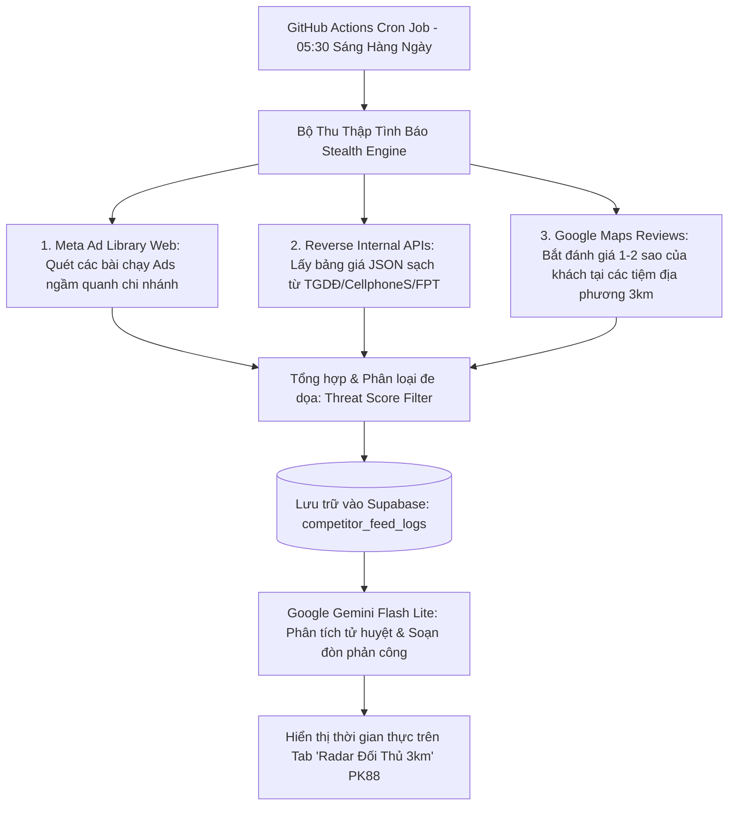

# KẾ HOẠCH NÂNG CẤP: HỆ THỐNG CÀO DỮ LIỆU TÌNH BÁO ĐỐI THỦ THỜI GIAN THỰC (RADAR 3KM)
**Dự án:** PK88 Automation Portal (Chuỗi Cửa Hàng Phụ Kiện 88)  
**Phân hệ áp dụng:** Radar Đối Thủ 3km — Xưởng Marketing 88 (`src/components/PK88MarketingStudio.tsx`)  
**Tài liệu lưu trữ dành cho:** Ban Lãnh Đạo & AI Agent kế tiếp khi bắt đầu bấm nút kích hoạt.  
**Ngày cập nhật mới nhất:** 19/10/2026  
**Trạng thái tính năng:** ⏸️ **TẠM HOÃN (ON-HOLD) — ĐÃ HOÀN TẤT THIẾT KẾ KIẾN TRÚC, SẴN SÀNG TRIỂN KHAI**

---

## 1. BỐI CẢNH & MỤC TIÊU DỰ ÁN
Hiện tại, phân hệ **"Radar Đối Thủ 3km"** trong Xưởng Marketing 88 đang hoạt động ổn định với tập dữ liệu tình báo định kỳ (danh sách đối thủ định sẵn quanh 7 chi nhánh, tọa độ GPS từ `google-maps.txt`, phân tích tử huyệt và sinh kịch bản phản công bằng Google Gemini AI).

**Mục tiêu nâng cấp khi kích hoạt:**
Chuyển đổi từ dữ liệu mô phỏng sang **Hệ thống Cào Dữ Liệu Thời Gian Thực (Live Stealth Scraping & Monitoring)** tự động quét ngầm mỗi sáng sớm để:
1. **Bắt trọn chiến dịch quảng cáo trả phí (Paid Ads)** của đối thủ đang chạy ngầm quanh địa bàn các chi nhánh.
2. **Theo dõi biến động bảng giá:** Bảng giá ép kính, thay pin, củ sạc, kính cường lực, combo flash sale của các chuỗi lớn và tiệm mạnh địa phương.
3. **Bắt tử huyệt phục vụ:** Quét các đánh giá tiêu cực (1–2 sao) của khách hàng tại các tiệm đối thủ trên Google Maps trong bán kính 3km.
4. **Tự động kích hoạt phản công:** Gemini Flash Lite đọc dữ liệu cào được, tự động phát hiện đối thủ đang giảm giá món gì hoặc khách đang chê đối thủ điều gì ➔ Viết sẵn kịch bản video TikTok và bài đăng Fanpage để nhân viên PK88 đăng bài hút khách ngay trong ngày.

---

## 2. BÀI HỌC KINH NGHIỆM & ĐÁNH GIÁ KỸ THUẬT PHƯƠNG ÁN CŨ

Trong bản phác thảo ban đầu (18/10), có 3 điểm nghẽn kỹ thuật đã được nhận diện và cần triệt tiêu:
* ⚠️ **Trần giới hạn thời gian chạy của Vercel (10 giây timeout):** Vercel Serverless gói Hobby tự động ngắt kết nối sau 10 giây. Quét 25–35 trang đối thủ qua mạng chắc chắn sẽ sập lỗi `504 Gateway Timeout`.
* ⚠️ **Tường lửa Meta (Facebook Login Wall):** Cào trực tiếp Fanpage qua IP server Vercel/AWS sẽ bị Meta chặn 100% bằng trang đăng nhập hoặc Captcha.
* ⚠️ **Website SPA (Single Page App):** Các web lớn (TGDĐ, CellphoneS, FPT Shop) render bảng giá bằng JavaScript client-side; nếu dùng `cheerio` tải HTML thô sẽ chỉ nhận được khung rỗng (skeleton).

---

## 3. KIẾN TRÚC KỸ THUẬT TINH VI ĐÃ NÂNG CẤP (4 ĐÒN BẨY CHIẾN LƯỢC)



### 🎯 Đòn Bẩy 1: Khai Thác Meta Ad Library (Thư Viện Quảng Cáo Facebook)
* **Nguyên lý:** Thay vì cào Fanpage đối thủ (dễ bị chặn và lẫn nhiều bài rác), hệ thống cào thẳng trang **Thư Viện Quảng Cáo công khai của Meta** (`facebook.com/ads/library`).
* **Lợi thế:**
  * Meta bắt buộc phải công khai 100% bài quảng cáo đang phân phối theo luật minh bạch toàn cầu.
  * Bắt trọn các **bài quảng cáo ngầm (Dark Posts)** mà đối thủ đang đổ ngân sách chạy quanh địa phương mà không đăng trên dòng thời gian Fanpage.
  * Hoàn toàn hợp pháp, không bao giờ bị chặn IP hay bắt đăng nhập.

### 🎯 Đòn Bẩy 2: Tấn Công Trực Tiếp Reverse-Engineered Internal APIs
* **Nguyên lý:** Không tải toàn bộ trang HTML 3MB rồi dùng `cheerio` bóc tách. Thay vào đó, gọi trực tiếp các API tìm kiếm/danh mục nội bộ dạng JSON của các chuỗi bán lẻ (`/api/v2/products`, `/graphql`).
* **Lợi thế:** Phản hồi trong 100ms, nhẹ gấp 50 lần, lấy chuẩn từng con số giá niêm yết, giá khuyến mãi và tình trạng còn hàng.

### 🎯 Đòn Bẩy 3: Radar Google Maps Reviews & Tình Báo Địa Bàn 3km
* **Nguyên lý:** Quét các đánh giá 1–2 sao mới nhất của khách hàng tại các tiệm sửa chữa/phụ kiện đối thủ tư nhân quanh bán kính 3km của shop.
* **Lợi thế:** Khai thác triệt để tử huyệt phục vụ (chờ lâu, thái độ cọc cằn, giá mập mờ) để AI của PK88 sinh kịch bản đập tan nghi ngờ của khách hàng.

### 🎯 Đòn Bẩy 4: Hạ Tầng GitHub Actions Engine (Khắc Phục Timeout Vercel)
* **Nguyên lý:** Chuyển tác vụ cào dữ liệu sang chạy bằng **GitHub Actions Scheduled Workflow** (05:30 sáng hàng ngày).
* **Lợi thế:**
  * Có sẵn 2.000 phút chạy miễn phí mỗi tháng trong kho lưu trữ GitHub của dự án.
  * Chạy trên máy ảo Ubuntu độc lập trong 2–3 phút thoải mái, không lo giới hạn 10 giây của Vercel.
  * Sau khi phân tích xong với Gemini AI, dữ liệu ghi thẳng vào Supabase. Vercel Portal chỉ việc đọc hiển thị trong 0.1 giây!

---

## 4. CƠ SỞ DỮ LIỆU CẦN THIẾT TRÊN SUPABASE (SQL SẴN SÀNG)

Khi người dùng ra lệnh kích hoạt, chỉ cần chạy đoạn SQL này trong Supabase SQL Editor:

```sql
-- 1. Bảng danh bạ các đối thủ trọng điểm theo từng chi nhánh PK88
CREATE TABLE IF NOT EXISTS competitor_monitors (
  id UUID PRIMARY KEY DEFAULT gen_random_uuid(),
  branch_id TEXT NOT NULL,                -- Chi nhánh PK88 (vd: PK88_PHUKHUONG, PK88_MYTHO...)
  competitor_name TEXT NOT NULL,           -- Tên tiệm đối thủ (vd: Mai Dũng Mobile, FPT Shop...)
  platform TEXT NOT NULL CHECK (platform IN ('ad_library', 'website_api', 'gmaps', 'tiktok')),
  target_identifier TEXT NOT NULL,         -- Page ID / Search Query / Endpoint API
  is_active BOOLEAN DEFAULT TRUE,
  last_scraped_at TIMESTAMPTZ,
  created_at TIMESTAMPTZ DEFAULT NOW()
);

-- 2. Bảng lưu vết tình báo cào được và kịch bản phản công của Gemini AI
CREATE TABLE IF NOT EXISTS competitor_feed_logs (
  id UUID PRIMARY KEY DEFAULT gen_random_uuid(),
  branch_id TEXT NOT NULL,
  competitor_id UUID REFERENCES competitor_monitors(id) ON DELETE CASCADE,
  competitor_name TEXT NOT NULL,
  feed_type TEXT NOT NULL,                -- 'PROMOTION_AD', 'PRICE_DROP', 'BAD_REVIEW'
  original_content TEXT,                  -- Tiêu đề / Nội dung bài quảng cáo hoặc đánh giá khách chê
  detected_price NUMERIC,                 -- Mức giá đối thủ đang áp dụng (nếu có)
  threat_level TEXT DEFAULT 'medium' CHECK (threat_level IN ('low', 'medium', 'high', 'urgent')),
  ai_counter_campaign JSONB,              -- Kịch bản TikTok, bài đăng Fanpage do Gemini viết
  scraped_date DATE DEFAULT CURRENT_DATE,
  created_at TIMESTAMPTZ DEFAULT NOW()
);

-- Chỉ mục tăng tốc độ truy vấn
CREATE INDEX IF NOT EXISTS idx_competitor_branch ON competitor_monitors(branch_id);
CREATE INDEX IF NOT EXISTS idx_feed_date_branch ON competitor_feed_logs(branch_id, scraped_date);
```

---

## 5. CHECKLIST THÔNG TIN NGHIỆP VỤ CẦN CUNG CẤP KHI KÍCH HOẠT

Khi Ban Điều Hành sẵn sàng hoàn thiện tính năng này, chỉ cần cung cấp các thông tin sau để nạp vào hệ thống:

### Danh sách 2–3 tiệm đối thủ "đáng gờm nhất" trên từng địa bàn:
* [ ] **Bến Tre (Phú Khương & Đồng Khởi):** Tên tiệm hoặc link Fanpage/Google Maps (vd: Mai Dũng Mobile...).
* [ ] **Tiền Giang (Mỹ Tho):** Tên tiệm hoặc link Fanpage/Google Maps.
* [ ] **Cần Thơ:** Tên tiệm hoặc link Fanpage/Google Maps.
* [ ] **Vĩnh Long:** Tên tiệm hoặc link Fanpage/Google Maps.
* [ ] **Thủ Đức (TP.HCM):** Tên tiệm hoặc link Fanpage/Google Maps.

### Nhóm mặt hàng / Dịch vụ mũi nhọn ưu tiên rình giá:
* [ ] **Dịch vụ Ép Kính:** Màn hình phẳng iPhone 11/12/13/14/15/16 hay màn hình cong Android?
* [ ] **Dịch vụ Thay Pin:** Pin Pisen, Pin Dung Lượng Cao, bảo hành 12 tháng?
* [ ] **Kính Cường Lực:** KingKong, Quaker, URR Sapphire, chống nhìn trộm?
* [ ] **Củ / Cáp Sạc:** Củ sạc nhanh 20W, 25W, 30W, 65W GaN?
* [ ] **Dán PPF / Skin mặt lưng / Lens Camera?**

---

## 6. LỘ TRÌNH THỰC THI (KHI CÓ LỆNH TRIỂN KHAI)
* **Giai đoạn 1 (30 phút):** Chạy SQL trên Supabase tạo 2 bảng `competitor_monitors` và `competitor_feed_logs`. Nạp dữ liệu danh bạ đối thủ theo danh sách cung cấp.
* **Giai đoạn 2 (1 giờ):** Tạo workflow GitHub Actions `.github/workflows/competitor-radar.yml` và script thu thập dữ liệu ngầm không token.
* **Giai đoạn 3 (45 phút):** Kết nối pipeline Gemini Flash Lite phân tích tự động mỗi 05:30 sáng và lưu kịch bản phản công vào Supabase.
* **Giai đoạn 4 (45 phút):** Cập nhật giao diện trong `PK88MarketingStudio.tsx` để hiển thị thẻ *"Tình Báo Đối Thủ Hôm Nay"* kèm nút *"Lấy Kịch Bản Phản Công Ngay"*.

---
*Tài liệu này đã được lưu trữ vĩnh viễn trong kho mã nguồn của dự án. AI Agent hoặc kỹ sư tiếp theo chỉ cần đọc tệp này là có thể bắt tay lập trình ngay lập tức mà không cần khảo sát lại từ đầu.*
